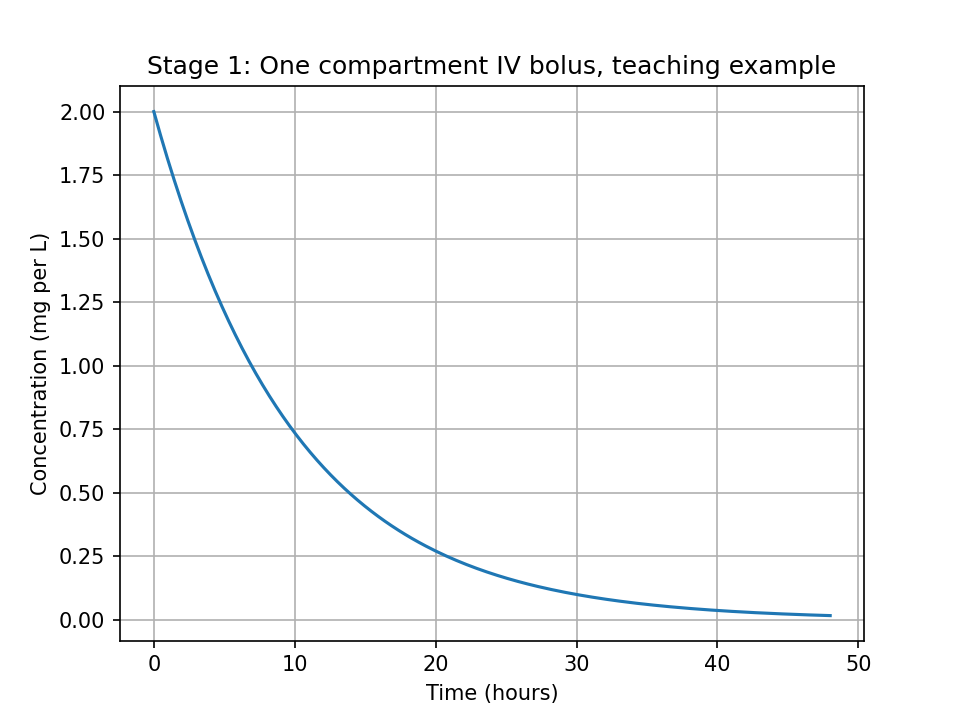
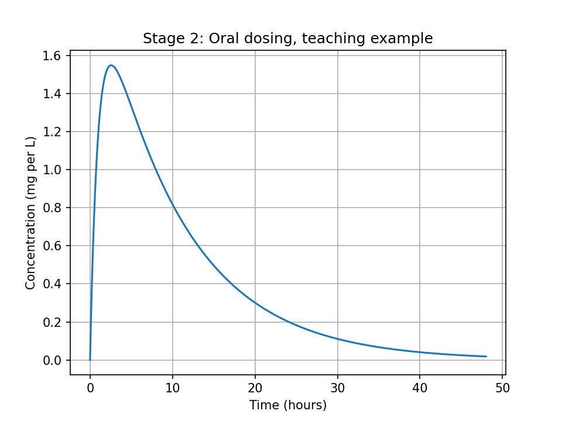
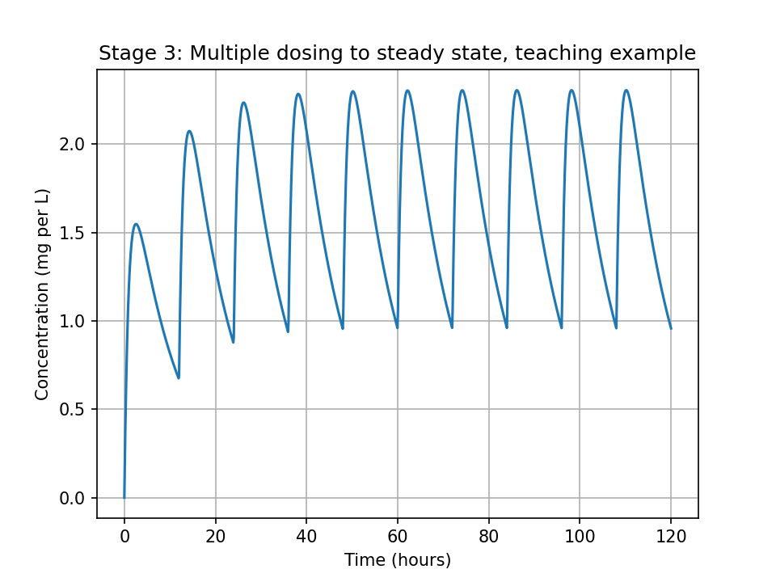
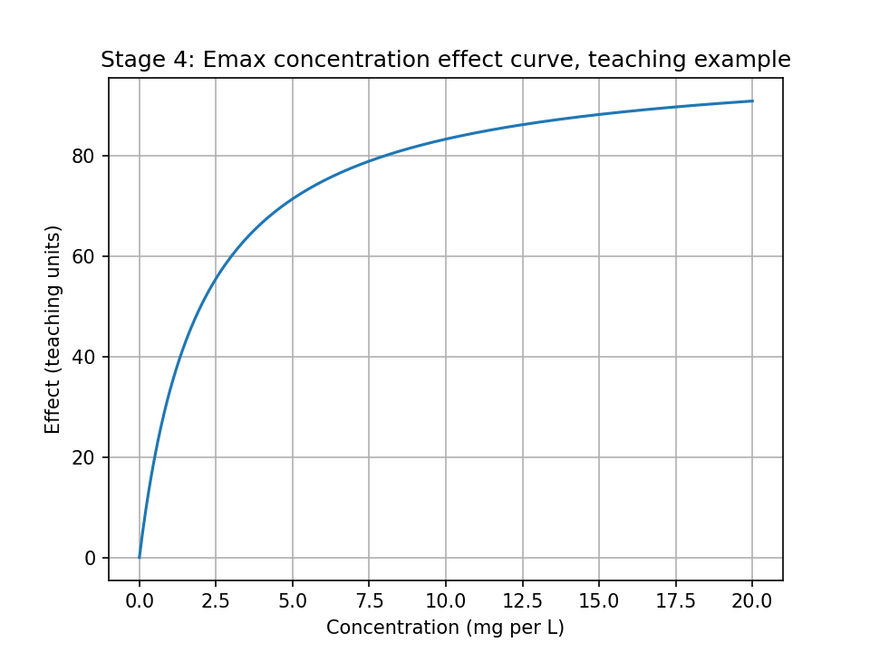
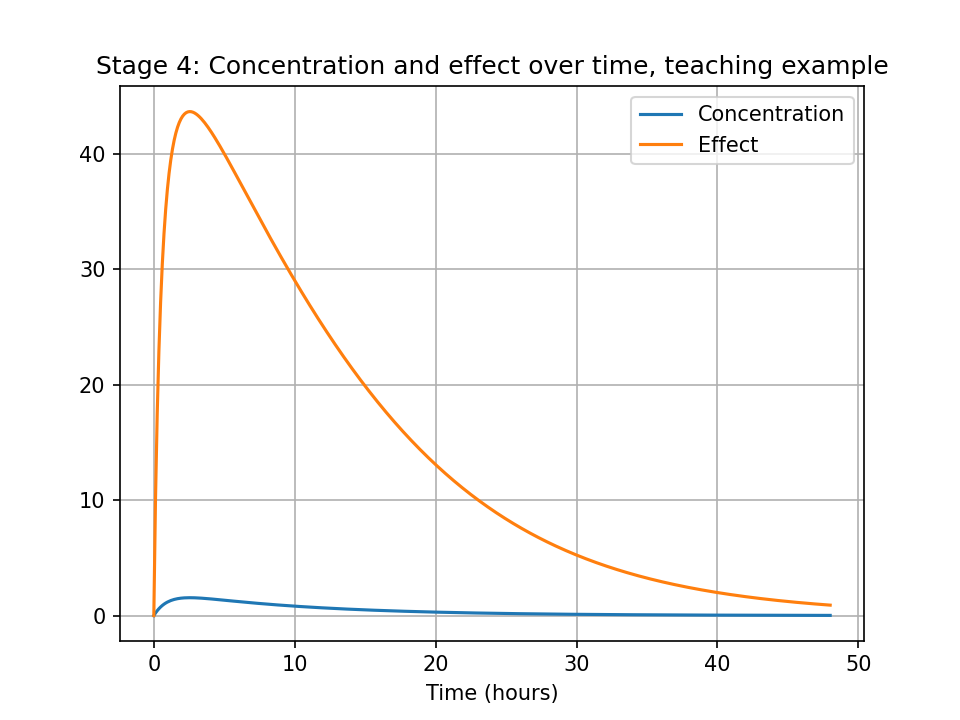
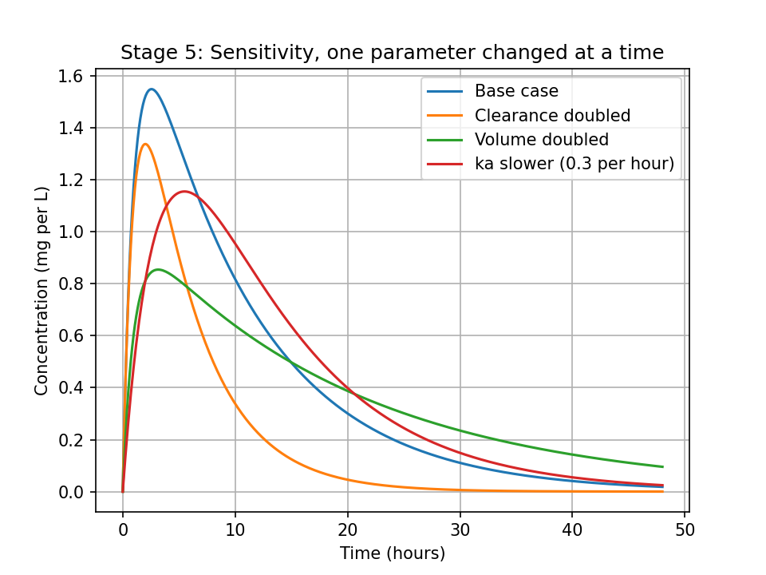
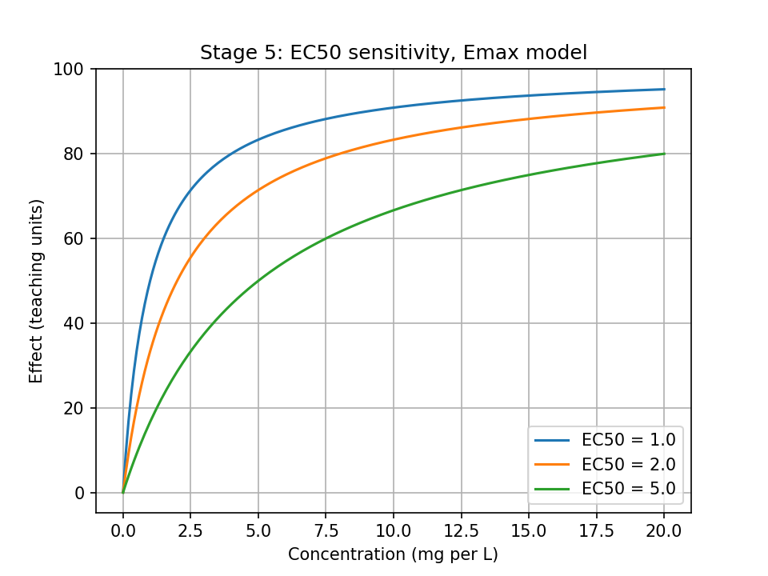

# PK/PD Simulation in Python, Project 5

Simulate concentration over time and effect over time with simple, transparent PK/PD models in Google Colab, one stage at a time.

Author: Masood Ur Rehman, MSc Drug Discovery and Development, Uppsala University

## What this project does
Builds a one compartment PK model step by step, adds oral absorption, then multiple dosing to steady state, then links concentration to effect with an Emax model, and finally tests how sensitive the curves are to clearance, volume, ka, and EC50.

## Teaching parameters, not a real drug
All simulations use clearly labelled teaching example parameters. They are not for any real drug, any real patient, or any real dose.
- Base case: Dose 100 mg, Volume (V) 50 L, Clearance (CL) 5 L per hour, absorption rate (ka) 1.0 per hour, bioavailability (F) 1.0
- Multiple dosing: 100 mg every 12 hours, 10 doses
- PD: Emax 100 effect units, EC50 2 mg per L

## Method
1. Stage 1: One compartment IV bolus. C(t) = C0 times exp(-k times t), k = CL divided by V, half life = ln 2 divided by k, AUC = Dose divided by CL. Plot 0 to 48 hours.
2. Stage 2: Oral dosing with first order absorption (Bateman function). Find Cmax and Tmax from the curve and from the formula, and compare them.
3. Stage 3: Multiple dosing by superposition. Report peak and trough in the last interval and peak after the first dose only.
4. Stage 4: PD link with the Emax model, Effect = Emax times C divided by (EC50 plus C). Plot the concentration effect curve and the effect time curve.
5. Stage 5: Parameter sensitivity. Change clearance, volume, ka, and EC50 one at a time, and write down what changed and why, plus honest limitations.

## Results
All results below are from the teaching example run in Google Colab on 26 Oct 2026, not from a real drug or a real patient.

| Item | Value |
|---|---|
| Stage 1 IV bolus | k 0.1 per hour, C0 2.0 mg per L, half life 6.93 hours, AUC 20.0 mg hour per L |
| Stage 2 oral | Cmax from curve 1.55 mg per L, Tmax from curve 2.53 hours, Tmax from formula 2.56 hours |
| Stage 3 multiple dosing | Peak in last interval 2.31 mg per L, trough at end of last interval 0.96 mg per L, peak after first dose only 1.55 mg per L, showing accumulation |
| Stage 4 Emax | Effect at EC50 50.0, effect at 10 times EC50 90.9, peak effect 43.6 |
| Stage 5 sensitivity | Clearance doubled: curve falls much faster. Volume doubled: peak much lower, about 0.85 mg per L, falls slower. Slower ka 0.3 per hour: peak later, about 5 to 6 hours, and lower, about 1.16 mg per L. Higher EC50: effect curve shifts right, more concentration needed for the same effect |

## Graphs
All 7 graphs from Stages 1 to 5, saved as PNG files by pkpd_all_graphs.ipynb.

### Stage 1: IV bolus

### Stage 2: Oral dosing

### Stage 3: Multiple dosing

### Stage 4: Emax curve

### Stage 4: Effect over time

### Stage 5: Sensitivity

### Stage 5: EC50 sensitivity

## Files
- `Project5_PKPD_Guide_Book.pdf`: the guide book (Google Colab, one stage at a time)
- `guide.html`: the same guide book as a web page
- `stage1_iv_bolus.ipynb`: Stage 1
- `stage2_oral_dosing.ipynb`: Stage 2
- `stage3_multiple_dosing.ipynb`: Stage 3
- `stage4_pd_emax.ipynb`: Stage 4
- `stage5_sensitivity_limitations.ipynb`: Stage 5
- `pkpd_all_graphs.ipynb`: runs all stages once and saves all 7 graphs as PNG files
- `pkpd_stage1_iv_bolus.png`, `pkpd_stage2_oral.png`, `pkpd_stage3_multiple_dosing.png`, `pkpd_stage4_emax_curve.png`, `pkpd_stage4_effect_time.png`, `pkpd_stage5_sensitivity.png`, `pkpd_stage5_ec50_sensitivity.png`: all 7 graphs

## Tools
Python, numpy, scipy, matplotlib, pandas, Google Colab

## Honest notes
- A simulated curve is not proof of how a real drug behaves.
- This is a one compartment model with first order absorption and elimination. Tissue distribution, protein binding, metabolism, kidney and liver function, age, weight, other medicines, and disease are all missing.
- The Emax link has no delay, no tolerance, and no feedback.
- Never use these teaching numbers to recommend a dose for a real patient. Real decisions need real data and qualified supervision.

## What to do after finishing
1. Fill in every MY RESULTS box in the notebooks and in this README with your own numbers.
2. Create the GitHub repo (only after finishing), in the same style as the Ames, Solubility, BBBP, and Docking repos.
3. Then update the CV and the portfolio with the finished project and its real numbers.

Educational project. Not a dosing guide, and not proof of a real drug's behaviour.
